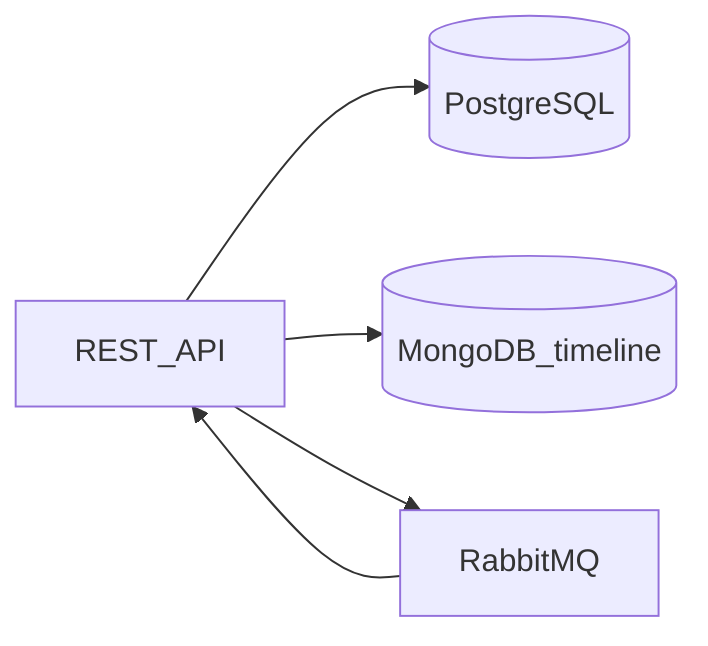

# Arquitetura — OS Service

## Bounded context

Clientes, veículos, catálogo, ordem de serviço (agregado raiz), outbox e projeção de status.

## Ecossistema

Visão dos três serviços e dependências: [components.md](components.md).

## Referência Saga

Detalhes de eventos: [saga-events.md](saga-events.md). ADR: [ADR-004](adr/ADR-004-saga-choreography-rabbitmq.md).
