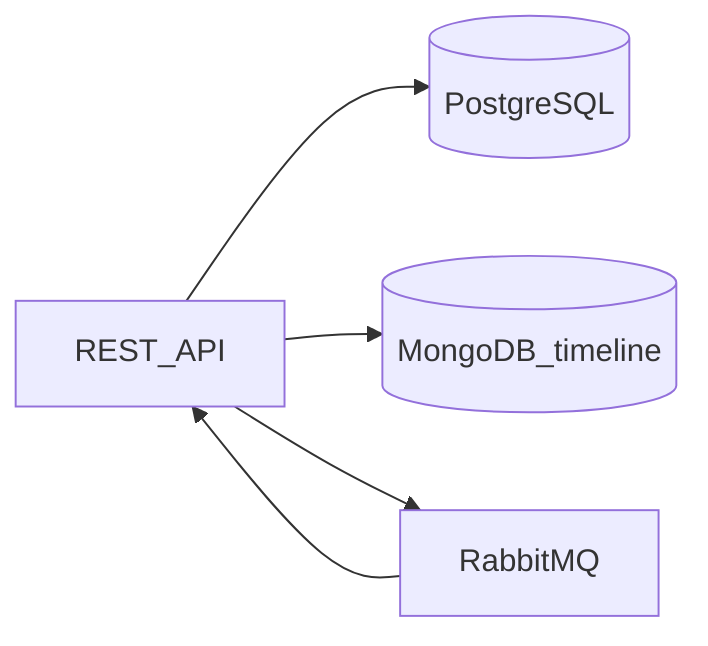

# Arquitetura — OS Service

## Bounded context

Clientes, veículos, catálogo, ordem de serviço (agregado raiz), outbox e projeção de status.

## Referência Saga

Detalhes de eventos: [saga-events.md](saga-events.md). ADR global no BFF: [ADR-004](https://github.com/TGuapyassu/oficina-api/blob/main/docs/architecture/adr/ADR-004-saga-choreography-rabbitmq.md).
