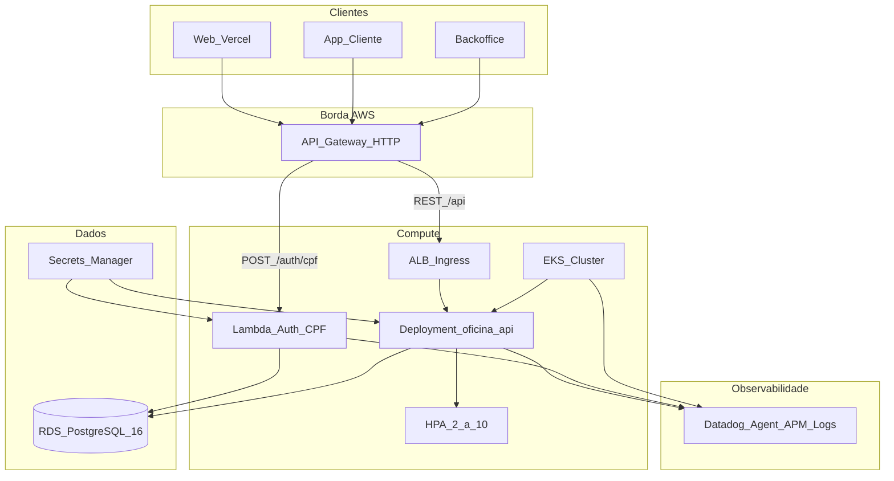

# Diagrama de Componentes

## Responsabilidades

| Componente | Repo | Função |
|------------|------|--------|
| API Gateway | `oficina-infra-k8s` | Roteamento, CORS, ponto único de entrada |
| Lambda Auth | `oficina-auth-lambda` | Validar CPF, consultar cliente, emitir JWT |
| EKS + HPA | `oficina-infra-k8s` + `oficina-api` | Escalabilidade da API |
| RDS | `oficina-infra-db` | Persistência gerenciada |
| Datadog | `oficina-infra-k8s` + app | Latência, CPU/mem, health, alertas OS |
