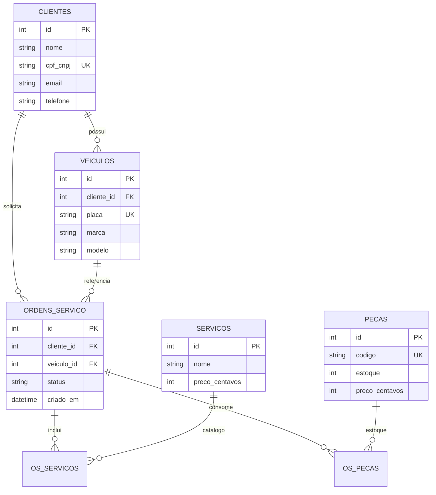

# Modelo Relacional e justificativa do banco

## Escolha: Amazon RDS PostgreSQL 16

**Justificativa formal**

1. **Consistência ACID** — OS, estoque e aprovações exigem transações (baixa de peças + mudança de status).
2. **Modelo relacional maduro** — entidades com FKs claras (cliente → veículo → OS → itens).
3. **Compatibilidade** — stack já usa SQLAlchemy 2 + Alembic + `psycopg2`.
4. **Operação gerenciada** — backups, Multi-AZ (prod), encryption at rest, parameter groups.
5. **Custo acadêmico/demo** — `db.t3.micro`/`small` suficiente para homolog.

Alternativas descartadas neste ciclo: DynamoDB (modelo de OS não é key-value puro); MySQL (equivalente, mas ecossistema do projeto já está em Postgres).

## Diagrama ER (conceitual)

## Ajustes de performance e consistência

| Ajuste | Motivo |
|--------|--------|
| `cpf_cnpj` UNIQUE + índice | Auth Lambda e busca de cliente O(1) lógico |
| FKs `cliente_id` / `veiculo_id` em OS | Integridade referencial |
| Status como enum/string validada no domínio | Transições controladas (DDD) |
| Migrations só via Job (não em cada pod) | Evita corrida com HPA |
| `log_min_duration_statement=1000` no parameter group | Visibilidade de queries lentas |

Migrations: `alembic/versions/` neste repositório.
